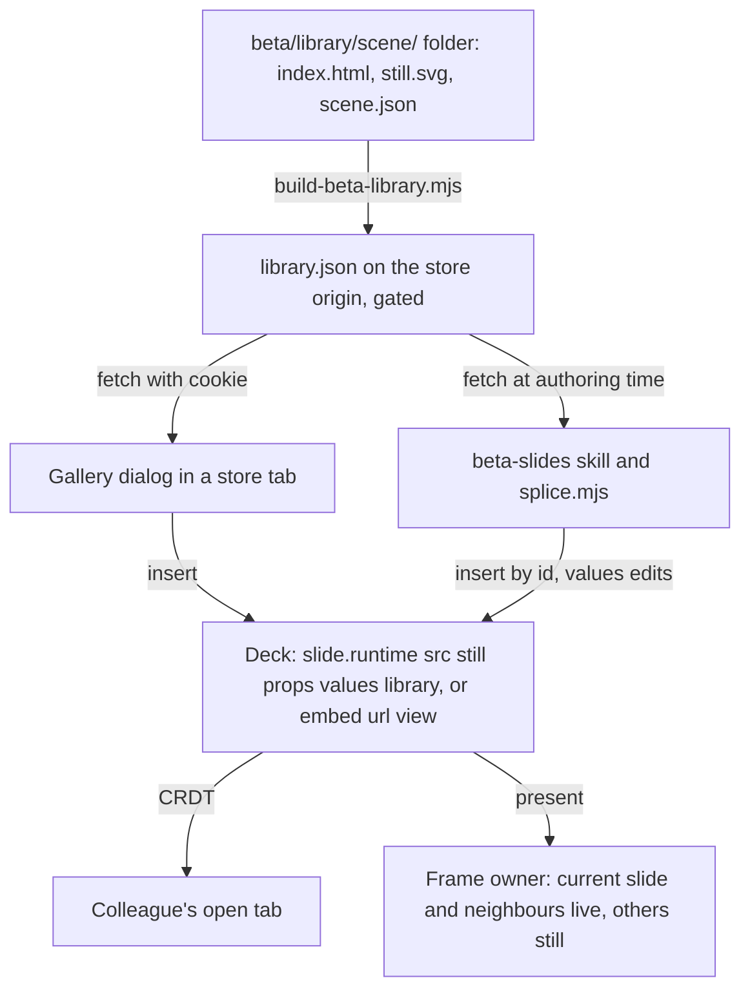
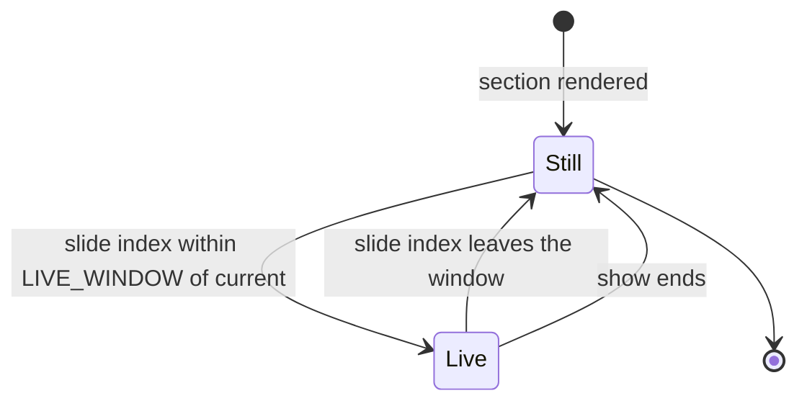
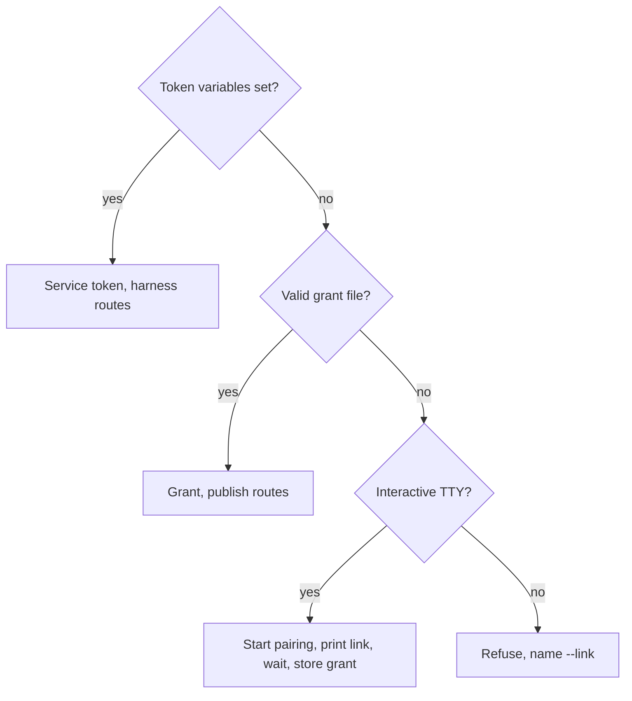

# Upstream Merge, Publishing Without a Secret, and a Live Scene Library - Plan

## Goal Capsule

- **Objective:** People at Beta can pick a live scene from a shared shelf, drop it on a slide, set it up for their talk and present it, while every Beta deck runs on a current build of bento/slides, and nobody is asked for a secret from 1Password to update a deck from a terminal.
- **Means:** three phases on the merged tree: the merge of upstream v1.2.7 (KTD1), browser approval as the way people publish (KTD6), and a Beta-owned scene library built on the runtime slide and the embed element the format already has (KTD8 to KTD10).
- **Authority:** `docs/PLATFORM.md` over this plan; `AGENTS.md` "Beta fork" rules over any unit's approach; this plan's Product Contract over its Planning Contract; the session-settled decisions recorded below over the defaults they replace.
- **Stop conditions:** a change under `kernel/src/` other than the three named files; a change that regenerates a `docId`; a deck that could choose its own frame sandbox or permissions; a release, a worker deploy or an Access change (maintainer only, on request); any reference to or dependency on a third-party fork.
- **Execution profile:** Phase A is one merge PR; Phase B is independent of the merge and may land first; Phase C is a chain of small PRs on the merged tree. Test-first on the worker rig and the splice rig; browser verification for every editor-visible unit.
- **Tail ownership:** the implementer opens PRs and asks Johan to cut releases, deploy the worker and make Access changes; Johan runs the acceptance on a real deck with a colleague.

---

## Product Contract

### Summary

Merge upstream v1.2.7 into the fork and keep it mergeable. Make browser approval the way a person's splice run gets into the deck store, with a lifetime long enough that a week of work asks once. Add a Beta-owned library of live scenes with a gallery, per-slide settings, stills everywhere a scene is not running, bounded liveness in the show, and a grid view of the slide list.

### Problem Frame

The fork's merge base is upstream 1.0.19 from 2026-09-05. Upstream is at v1.2.7 with 192 commits since, and a dry-run merge reports 57 conflicted files. Upstream has since shipped a PowerPoint library under `convert/`, a generated JSON schema stamped into every saved deck, sidebar multi-select, and a web embed element, all of which overlap work the fork carries.

Every live thing on a Beta slide today is a runtime slide Claude authors for one deck. There is no shelf a person can pick from, no settings form, and the still a runtime slide carries is whatever Claude drew. A colleague's fork of bento showed the shape that works for reuse: a registry of scenes, each with a settings schema, settings that travel with the instance as plain data, a thumbnail per live element, and a light table. None of that code is used here; the patterns are.

Updating a stored deck from a terminal goes through the splice tool, which prefers the Cloudflare Access service token, and the skill tells people to fetch that token from 1Password. Every person who updates a deck is prompted by the 1Password CLI for a credential the product was built never to require of them. The pairing route that needs no secret already exists, but it is documented as the Cowork fallback and its grant lasts eight hours.

### Key Decisions

- **Inspiration only; nothing from the colleague's fork is referenced, vendored or depended on.** (session-settled: user-directed, chosen over asking him to host a manifest or offer fields upstream: Beta owns what Beta ships.) Governs R20, R21.
- **Upstream merge first; features are built on the merged tree.** (session-settled: user-approved, chosen over building on the current base and merging later: the features touch the files the merge conflicts on.) Governs R1, R9.
- **A deck never chooses its own frame sandbox or permissions.** (session-settled: user-approved, chosen over a document-controlled `sandbox`/`allow` pair: every deck is untrusted input, `docs/PLATFORM.md`.) Governs R15.
- **The 1Password prompt goes away by making browser approval the way people get in, not by caching the service token on their machines.** Governs R5, R6.
- **Scenes in the library are Beta-owned and reviewed, served from the store origin behind Access.** Governs R9, R11.
- **A library scene is either a whole-slide runtime slide or an in-slide web embed; no new element type.** Governs R10, R12.

### Requirements

**Phase A: current with upstream**

- R1. The fork's `main` contains upstream v1.2.7 by a merge commit, and every rig in the `beta` CI job is green on the merged tree.
- R2. Generated files (`slides/src/modelkeys.generated.ts`, `slides/src/i18n/packed.ts`, `schema/slides.json`, `slides/package-lock.json`) are regenerated, never hand-merged, and Beta's own UI strings are present in every core catalogue so the language-coverage rig stays green.
- R3. The fork keeps exactly one PowerPoint exporter, chosen by a test that exports a Beta template deck and a deck with runtime slides through both; the editor's export button and the skill's command keep working either way.
- R4. A saved Beta deck advertises a schema that accepts it: the published schema describes `slide.runtime`, and the `$schema` stamp points at a Beta-served copy.
- R19. Existing stored decks receive the new shell the way they already do: the signed update channel, applied in place from a store tab by the person who accepts it.
- R22. Every Beta hook inside an upstream file carries the single marker token `BETA FORK`, a rig fails CI when a hook lacks it, and a written smoke checklist names what only the fork does.

**Phase B: publishing without a secret**

- R5. A person running the splice tool with no credential in an interactive terminal is offered the pairing link immediately; the tool never asks for a token and never mentions 1Password.
- R6. The service token is used only when its variables are set explicitly; a non-interactive run with no credential refuses and starts no pairing.
- R7. A grant lasts long enough that a week of ordinary work asks for approval once; the approval page states the lifetime in one sentence, and the lifetime is one constant the rigs cross-check.
- R8. The Agent access list shows each grant's label, start and end, and a person can revoke any of their own grants; the label distinguishes Claude Code from Cowork.

**Phase C: the scene library**

- R9. A library manifest on the store origin lists reusable scenes, each with an id, a version, a name, a still, a settings schema with defaults, and presets; it is fetched by the gallery and by the skill, never restated.
- R10. A person inserts a library scene from a gallery dialog in the editor; a runtime scene fills a new slide with its HTML inlined and its still as the slide's image element; a web scene becomes an embed element with the library-provided view and its URL.
- R11. The gallery is available in a deck opened from the store; a deck opened from a file or offline shows why the gallery is unavailable instead of a failed fetch.
- R12. Settings travel in the deck as plain fields: on a runtime scene as `runtime.values` beside its declared `props`; on a web scene as the URL's query string; collaborators in a live session see a change without reload.
- R13. The properties panel shows a settings form for an inserted scene, drawn from the instance's declared schema, with presets; the form writes only the settings fields.
- R14. Every live element has a still: the library still for a library scene, the existing placeholder box for a web embed added by hand.
- R15. In present mode the current slide and its two neighbours hold live frames; every other slide holds its still; runtime slides and web embeds follow the same rule from one owner.
- R16. The slide list has a grid view with multi-select drag, a visible drop gap, double-click to open a slide and Escape back to the list; state slides follow their parents.
- R17. The splice tool can insert a library scene by id with values and change a library instance's values by slide id; a replace of a library-marked runtime slide keeps the person's values unless the folder declares the same library id.
- R18. A settings kind the shipped shell does not know rides on a kind it does know with a format hint, so an older shell saving the deck strips nothing.
- R20. Library scenes are authored by Beta in this repo and published with the site; the manifest is generated from their folders, not written by hand.
- R21. No code, manifest or URL from any third-party fork appears in the tree.

### Acceptance Examples

- AE1. **Covers R1, R2.** Given the merged tree, when CI runs the `beta` job, then every rig passes and `build-modelkeys --check`, `build-i18n --check` and `build-schema --check` report current files.
- AE2. **Covers R5.** Given no `CF_ACCESS_CLIENT_ID`, no grant file and a TTY, when a person runs `splice.mjs --create`, then the tool prints an approval link and waits, and no output mentions 1Password or a token.
- AE3. **Covers R6.** Given no credential and no TTY, when the splice tool runs, then it exits with a refusal naming `--link` and starts no pairing.
- AE4. **Covers R7.** Given a grant approved on Monday morning, when the same person publishes on Friday, then no approval is asked.
- AE5. **Covers R10, R12.** Given Robert inserts the map scene with a position preset while Anna has the deck open, when the slide lands, then Anna sees the new slide with its still and, on entering it in present mode, the scene at Robert's position.
- AE6. **Covers R17.** Given a library slide whose values a person changed, when Claude splices an edits file that changes one value, then the other values survive and the changed value lands; when Claude replaces the slide from a folder that does not declare the library id, then the splice refuses and names the slide.
- AE7. **Covers R15.** Given a deck with six library scenes, when the show is on slide three, then exactly slides two, three and four hold frames, counted in devtools.
- AE8. **Covers R11.** Given the deck is opened from a downloaded file, when the gallery button is pressed, then the dialog says the library is available from the store and offers the deck's store link when one is known.
- AE9. **Covers R16.** Given slides 2 and 5 selected in the grid, when they are dragged between 7 and 8, then the drop gap shows there, the order becomes 1,3,4,6,7,2,5,8, and undo restores it.
- AE10. **Covers R18.** Given a scene with a `select` setting, when the deck is saved by a shell built before this plan, then the setting and its value are still in the file.
- AE11. **Covers R4.** Given a deck saved by the new shell, when an agent validates it against the URL in its `$schema` key, then a deck with runtime slides validates.
- AE12. **Covers R22.** Given a Beta hook added to `editor.ts` without the marker, when CI runs, then the marker rig fails and names the line.

### Success Criteria

- A colleague who has never used the terminal flow publishes a deck update from Claude Code with one browser click and no other prompt.
- Johan's acceptance: a deck with three library scenes, built by a colleague from the gallery, presented on a projector, then updated by Claude through the splice tool without losing the colleague's settings.
- The next upstream release merges in one sitting with conflicts only in files the AGENTS.md "Beta fork" section already names.

### Scope Boundaries

**Considered and not built**

- **Live previews on the editor canvas.** The canvas re-renders on every edit and a frame there would navigate to the scene's URL on each repaint, which is why upstream keeps the canvas still-only (`slides/src/render.ts`, embed case). The still is the canvas. Evidence that would change this: a scene whose still cannot convey its state and a measured, cheap way to keep one inert frame alive across re-renders.
- **A bulk reshell of every stored deck.** R19 covers delivery through the existing update channel. A maintainer script that re-splices every stored deck into the new shell through the service token would push a service write at every open tab at once. Evidence that would change this: decks that nobody opens for weeks and still need the new shell.
- **Sliding, self-renewing grants.** A fixed longer lifetime meets R7. Renewal needs a refresh route, token rotation, a grace window and an audit record on a store where KV writes are limited to one per key per second and revocation lags by about a minute (research in Sources). Evidence that would change this: a lifetime decision measured in months, where a fixed grant becomes the larger risk.
- **A public, credential-free manifest.** Gated on the store origin by Key Decision. Evidence that would change this: partners outside Beta needing the gallery from file-based decks.

**Deferred to Follow-Up Work**

- Splice parity for web embeds: `embed` has no entry in the tool's content map, so Claude edits a web scene's settings only after a `url` carve-out is designed.
- Audit fields on a grant (last used, write count) and an admin revoke of all grants for an email; needed if the lifetime chosen under R7 is measured in weeks.
- Capturing a view for a web embed added by hand (a raster still wrapped in an svg carrier).
- Widening the live window beyond one neighbour, after the measurement in U13's verification.
- Converting the colleague's reveal.js decks to library scenes.

**Outside this feature**

- The colleague's scene panel, served JSON mode, archive export and MQTT widgets.
- Any change to Drive or Cowork integration beyond the skill text.

### Dependencies / Assumptions

- Phase B touches only `plugins/beta-slides/` and `server/deck-store/`, which the upstream delta does not reach; it can land before or alongside Phase A.
- Upstream's `convert/` exporter exports an embed's view as PNG and would export a runtime slide's still as an image (CHANGELOG 1.2.7); verified by U2's test, not assumed.
- Cowork may not keep `~/.bento` between sessions; the skill says so, and a longer grant is a Claude Code benefit first.
- The deck store worker and the Access application are changed only by Johan; units name those steps and stop there.

### Outstanding Questions

**Deferred to Implementation**

- Whether the Cloudflare Access cookie reaches a sandboxed frame's navigation from a store tab; moot while scene HTML is inlined (KTD8), measured once in U13 for web scenes that point at gated URLs.
- Whether upstream's `test-embed.ts`, `test-slides-multiselect.ts` and `test-schema.ts` pass unchanged on the merged tree or need the fork's expectations.

**Johan's decisions, with defaults the plan proceeds on**

- The grant lifetime under R7. Default: 14 days, fixed, stated on the approval page as "This approval lasts 14 days or until you revoke it."
- The two seed scenes for the library under R20. Default: a map scene and a counter scene, authored in `beta/library/`.

### Sources

- `docs/DECISIONS.md` entries 2026-08-19 (embed shape), 2026-09-14 (runtime slides), 2026-09-16 (pairing and grants).
- `docs/plans/2026-09-14-001-feat-runtime-slides-plan.md` and `docs/plans/2026-09-15-001-feat-one-click-publish-pairing-plan.md`.
- `docs/solutions/design-patterns/idle-tab-follows-the-store-auto-reload.md`: how a service write reaches open tabs.
- Upstream v1.2.7 (`git show v1.2.7:…`): `slides/src/schema.ts`, `scripts/build-schema.mjs`, `slides/src/render.ts` embed case, `slides/src/present.ts` section render, `slides/src/editor/editor.ts` sidebar drag.
- RFC 9700 (OAuth 2.0 Security Best Current Practice) section 4.14 on refresh-token rotation for public clients; Cloudflare Workers KV limits (60 s minimum TTL, one write per key per second, eventual consistency). Both shaped the decision to keep a fixed lifetime.

---

## Planning Contract

### Key Technical Decisions

- KTD1. **Merge v1.2.7 by tag with a merge commit in this worktree, not a rebase and not a squash.** A rebase replays thirty Beta commits through the same hot files; a squash loses the ancestry the next merge needs. Regenerate `modelkeys.generated.ts`, `packed.ts` and `schema/slides.json` from their generators; take upstream's `package-lock.json` and run `npm install`; take upstream's core catalogues and re-add Beta's strings from the fork's own diff against the merge base, because `scripts/test-i18n-coverage.mjs` requires every core catalogue to carry every key the source uses. (session-settled: user-approved, chosen over features first: the features land in the files the merge conflicts on.)
- KTD2. **Prefer upstream's `convert/` exporter and retire `slides/src/export/pptx.ts` when U2's test shows no loss on Beta decks.** One exporter is one set of degradations to explain; the fork keeps the export button and `scripts/export-pptx.mjs` as thin calls into whichever wins. The test, not the plan, decides.
- KTD3. **The runtime schema is a `.schema` annotation on the `runtime` entry of `SLIDE_CHECKS` in `slides/src/untrusted.ts`, and the fork stamps its own `SCHEMA_URL` on the store origin.** Upstream's generator reads `checks[key].schema ?? {}`, so an unannotated check publishes an empty object and an agent validating a Beta deck learns nothing about runtime slides; the stamp otherwise points every Beta deck at a schema that rejects it. The schema file is served from a new public path on the store, which is a worker allowlist entry plus an Access Bypass destination (maintainer step).
- KTD4. **One marker token, `BETA FORK`, on every hook line inside an upstream file, enforced by `scripts/test-beta-markers.ts`.** Two spellings exist today (`BETA FORK`, `Beta build:`) across about forty sites, and the sweep that normalises them is part of the merge. The rig lists hooks by diffing the fork against the upstream tag in the files upstream owns and asserting each added hunk carries the token; code that upstream now owns byte for byte loses its marker.
- KTD5. **The `beta` CI job runs every upstream rig whose subject the fork touches.** `test-ci-registered.ts` only checks that a filename appears somewhere in `ci.yml`, so a rig left in the gated-off `validate` job passes registration while never running. After the merge the job gains `test-embed`, `test-slides-multiselect`, `test-schema` and, if KTD2 keeps it, `test-convert`.
- KTD6. **Pairing is the path for people; the service token is for machines and wins only when its variables are set.** `config()` keeps its precedence (a leftover grant file must never reroute a machine run), but with no credential and a TTY the tool starts the pairing itself and prints the link, where today it refuses and names 1Password. Non-interactive runs refuse. The skill stops sending people to 1Password anywhere.
- KTD7. **The grant lifetime is one constant, `GRANT_TTL_S` in `server/deck-store/src/grant.js`, raised to the value Johan picks (default 14 days), with the approval page, `CONCEPTS.md` and the skill text cross-checked by the existing rigs.** Fixed, not sliding (Scope Boundaries). The label comes from an environment variable with the Cowork default so the access list tells Claude Code grants apart.
- KTD8. **A library scene's HTML is copied into the deck at insert; the manifest is fetched from a gated route on the store origin.** A URL-referenced scene behind Access paints an error document over its still inside a sandboxed frame, cannot receive assets and cannot work offline. Inline is the shape `applyScene` in the splice tool already writes. The deck grows by the scene's size, bounded by the existing `RUNTIME_SRC_BUDGET`.
- KTD9. **An inserted runtime scene carries `runtime.library = { id, version }` plus its own copy of `props` and the chosen `values`.** Self-describing offline, editable in the panel without the manifest, and the marker is what the splice tool's ownership rule keys on (R17). New field kinds ride on `text` and `number` with a `format` hint (`select`, `bool`, `latlon`, `range`) because `checkRuntime` drops unknown kinds and a downloaded copy on an older shell would strip them on save (R18).
- KTD10. **A web scene is upstream's `embed` element with `app: 'web'`, `live: true`, the library's `view`, and settings in the URL query string, rewritten by the panel form.** The frame's sandbox stays the shell's (`allow-scripts allow-forms`, never from the document). Settings parsing and writing is one pure module shared by the gallery and the panel.
- KTD11. **One frame owner for both scene kinds, in `slides/src/runtime-present.ts`, with the live window a constant `LIVE_WINDOW = 1`.** Today embed frames are appended at render for every section when the show starts, while runtime frames are mounted on slide enter; two models cannot share a window. The owner mounts frames for the current slide and its neighbours on every slide change and tears down the rest; the embed case in `render.ts` stops appending a frame under `liveMedia` and the owner adds it.
- KTD12. **The grid view is a class on the existing sidebar plus pure geometry helpers in `slides/src/beta/lighttable.ts`.** Upstream v1.2.3 and later already carry `thumbSel`, shift and modifier selection, `dropSlides` and states following parents; the fork adds the grid layout, row-aware drop-gap geometry, a drop bar, double-click and Escape. No second slide list.
- KTD13. **The manifest is generated by `scripts/build-beta-library.mjs` from `beta/library/<scene>/` folders and published with the site; the skill fetches it at authoring time like it fetches the agent guide.** One source for the gallery, the skill and the splice tool's validation of values.
- KTD14. **Library stills stay under 64 KB and inline.** Larger assets travel as relay blobs and a live colleague sees a blank slide until they arrive; the first-page preview budget already asks for about 45 KB.

### High-Level Technical Design

Where a scene's data lives and who reads it:

Frame ownership in present mode, after KTD11:

How a person's splice run gets in, after KTD6:

### Implementation Constraints

- Beta code lives in `slides/src/beta/`, `slides/src/runtime*.ts`, `beta/`, `plugins/beta-slides/`, `server/deck-store/`, `scripts/build-beta-*` and `scripts/test-beta-*`; an upstream file receives one marked hook per surface.
- Every new slide or element key is a three-place change: `model.ts`, the check table in `untrusted.ts` with its schema annotation, regenerated `modelkeys.generated.ts` and `schema/slides.json`.
- New UI strings go through all core catalogues after the merge; the fork's build is English-only but the coverage rig is not.
- Any change to `kernel/src/sync/crdt.ts` is out of scope; settings are whole-object last-writer-wins, documented beside the table limitation.

---

## Implementation Units

| U-ID | Title | Key files | Depends on |
|---|---|---|---|
| U1 | Merge upstream v1.2.7 | `slides/src/*`, `kernel/src/app.ts`, `kernel/src/sync/online.ts`, generated files | none |
| U2 | One PowerPoint exporter | `slides/src/export/pptx.ts`, `scripts/export-pptx.mjs`, `convert/` | U1 |
| U3 | Runtime schema and the fork's schema URL | `slides/src/untrusted.ts`, `slides/src/schema.ts` hook, `server/deck-store/src/worker.js` | U1 |
| U4 | Marker rig, CI job, smoke checklist, sync runbook | `scripts/test-beta-markers.ts`, `.github/workflows/ci.yml`, `docs/beta-smoke.md`, `AGENTS.md` | U1 |
| U5 | Release and shell delivery check | maintainer release; `scripts/check-store-live.mjs` | U1 to U4 |
| U6 | Pairing is the path for people | `plugins/beta-slides/scripts/splice.mjs`, `plugins/beta-slides/skills/beta-slides/SKILL.md` | none |
| U7 | Grant lifetime and label | `server/deck-store/src/grant.js`, `server/deck-store/src/pages.js`, `CONCEPTS.md`, `docs/DECISIONS.md` | none |
| U8 | Library folders, build script, gated manifest route | `beta/library/`, `scripts/build-beta-library.mjs`, `server/deck-store/src/worker.js` | U1 |
| U9 | Library fields in the format | `slides/src/model.ts`, `slides/src/runtime.ts`, `slides/src/untrusted.ts`, generated files | U3 |
| U10 | Settings module and panel form | `slides/src/beta/scenesettings.ts`, `slides/src/editor/panels.ts` | U9 |
| U11 | Gallery dialog and insert | `slides/src/beta/gallery.ts`, `slides/src/editor/editor.ts` | U8, U9, U10 |
| U12 | Splice: library insert and values carve-out | `plugins/beta-slides/scripts/splice.mjs`, skill docs | U8, U9 |
| U13 | One frame owner with a live window | `slides/src/runtime-present.ts`, `slides/src/render.ts`, `slides/src/present.ts` | U1 |
| U14 | Light table grid | `slides/src/beta/lighttable.ts`, `slides/src/editor/editor.ts`, `slides/src/styles.css` | U1 |
| U15 | Acceptance on a real deck | none (verification) | U5, U7, U11 to U14 |

### Phase A: current with upstream

### U1. Merge upstream v1.2.7

- **Goal:** `main` contains v1.2.7 by a merge commit with every rig green.
- **Requirements:** R1, R2, R19. KTD1.
- **Dependencies:** none.
- **Files:** every conflicted file from the dry run; `scripts/build-modelkeys.mjs`, `scripts/build-i18n.mjs`, `scripts/build-schema.mjs` (arrives with the merge); `slides/src/i18n/*.ts`; `CHANGELOG.md` (keep both sections); `docs/DECISIONS.md` (keep both); `AGENTS.md` (upstream section re-synced verbatim, `CLAUDE.md` back to the wrapper).
- **Approach:**
  1. Tag the pre-merge head, then `git merge v1.2.7` in this worktree; resolve the eleven source files by keeping both sides, upstream's text winning where a Beta hook merely moved.
  2. Take upstream's version of every generated file and lockfile, run the generators and `npm install`.
  3. Take upstream's eight core catalogues, then re-add the Beta entries recovered from the fork's diff against the merge base, and let `build-i18n` repack.
  4. `slides/package.json` keeps Beta's dated version; record upstream's version in the CHANGELOG section.
  5. Run the kernel sync rigs with a large seed count since `online.ts` gained several hundred upstream lines.
  6. Check divergence in both directions before opening the PR.
- **Execution note:** run every rig in the `beta` job locally before the PR; a red rig is a regression or a fork divergence to remove, never a rig to skip.
- **Patterns to follow:** `AGENTS.md` "Beta fork" rule 4 for the predictable conflicts; the About-dialog fragment pattern in `docs/plans/2026-09-08-002-feat-beta-slides-v1-1-plan.md` KTD2 for keeping hooks small.
- **Test scenarios:**
  - The `beta` CI job passes on the merged tree.
  - `node scripts/test-sync.ts` with `SEEDS=300` converges.
  - A deck saved by the pre-merge shell opens in the merged shell with every runtime slide intact.
  - A deck saved by the merged shell carries a `$schema` key as its first key, and `splice.mjs --read` of that deck lists its elements without a refusal.
  - A store tab that accepted the update saves the deck with the new shell; the grant replace path still answers `400 shell` only when a grant run swaps a shell, not after a person's update.
- **Verification:** CI green on the PR; both-direction divergence shows only the merge; the three-file kernel footprint is unchanged.

### U2. One PowerPoint exporter

- **Goal:** the fork ships one exporter, chosen by evidence.
- **Requirements:** R3. KTD2.
- **Dependencies:** U1.
- **Files:** `slides/src/export/pptx.ts`, `scripts/export-pptx.mjs`, `scripts/test-beta-pptx.ts`, upstream `convert/src/export.ts`, `slides/src/editor/editor.ts` (export hook).
- **Approach:** export the Beta general template and a deck with two runtime slides through both exporters; compare shapes, fonts, theme colours, the runtime stills and the degradation report. If upstream's output is equal or better on Beta decks, delete the fork's exporter and point the button and the script at `convert/`; otherwise keep the fork's and record why in `docs/DECISIONS.md`.
- **Test scenarios:**
  - A runtime slide exports as its still, full-bleed, in the chosen exporter.
  - Beta fonts and theme colours survive in the exported file.
  - The degradation report names anything approximated.
- **Verification:** one exporter remains in the tree; the skill's command produces a file from a Beta template deck.

### U3. Runtime schema and the fork's schema URL

- **Goal:** a saved Beta deck advertises a schema that accepts it.
- **Requirements:** R4. KTD3.
- **Dependencies:** U1.
- **Files:** `slides/src/untrusted.ts` (annotate the `runtime` check), `slides/src/schema.ts` or the fork's `SCHEMA_URL` hook (one marked line), `schema/slides.json`, `server/deck-store/src/worker.js` (`PUBLIC_PATHS` entry), `scripts/publish-site.mjs`, `scripts/check-store-live.mjs`, `scripts/test-beta-schema.ts`.
- **Approach:** describe `runtime` with the same JSON Schema vocabulary upstream's `tag()` uses, built beside `checkRuntime` without importing `untrusted.ts`; point the stamp at the store origin; publish the file with the site. Access Bypass destination for the new path is a maintainer step recorded in the unit.
- **Test scenarios:**
  - `build-schema --check` passes and the published schema has a `runtime` definition under `slide`.
  - A runtime deck validates against the published schema with a standard validator; a deck with an unknown slide key fails.
  - The live check lists the schema path as public.
- **Verification:** the schema URL answers without a login after the Access change; validation of a runtime deck passes.

### U4. Marker rig, CI job, smoke checklist, sync runbook

- **Goal:** the fork stays cheap to merge.
- **Requirements:** R22. KTD4, KTD5.
- **Dependencies:** U1.
- **Files:** `scripts/test-beta-markers.ts`, `.github/workflows/ci.yml` (`beta` job), `docs/beta-smoke.md`, `AGENTS.md` (Beta fork section: sync runbook, marker rule).
- **Approach:** normalise every hook to `BETA FORK`; the rig diffs the fork against the upstream tag named in `AGENTS.md` for the files upstream owns and fails on an added hunk without the token, and on a marker in a hunk that is byte-identical upstream; add the upstream rigs KTD5 names to the `beta` job; write the smoke checklist as the acceptance list for what only the fork does (store save, runtime slides, pairing, gallery, light table, liveness, PPTX).
- **Test scenarios:**
  - A hook without the token fails the rig and names the file and line.
  - A marker on code upstream now owns fails the rig.
  - `test-ci-registered.ts` and the new rig both pass on the merged tree.
- **Verification:** CI green; `git grep -n "BETA FORK"` lists the whole footprint.

### U5. Release and shell delivery check

- **Goal:** the merged shell reaches stored decks.
- **Requirements:** R19.
- **Dependencies:** U1 to U4.
- **Files:** none in the tree; maintainer release per README "Releasing".
- **Approach:** Johan cuts the release; open a stored deck in a store tab, accept the update chip, confirm the deck's shell is the new one on the next read and that an idle second tab reloads onto it.
- **Test scenarios:** `Test expectation: none -- maintainer release; the check above is the verification.`
- **Verification:** two stored decks on the new shell by the update path; `check-store-live.mjs` sweep green.

### Phase B: publishing without a secret

### U6. Pairing is the path for people

- **Goal:** no person is told to fetch a token.
- **Requirements:** R5, R6, R8. KTD6.
- **Dependencies:** none.
- **Files:** `plugins/beta-slides/scripts/splice.mjs` (`config`, `link`, the three refusal messages, `LINK_LABEL`), `plugins/beta-slides/skills/beta-slides/SKILL.md`, `docs/agents.md` where it names the token, `scripts/test-beta-splice.ts`, `scripts/test-beta-skill.mjs`.
- **Approach:**
  1. With no credential and a TTY, `config()` starts a pairing, prints the link, polls and stores the grant, then continues the run.
  2. With no credential and no TTY, refuse naming `--link`; never mention 1Password.
  3. The label is read from `SLIDES_GRANT_LABEL` with the Cowork default; Claude Code sessions set it through the skill.
  4. Rewrite the skill's publishing steps: pairing first, token under a "machines and CI" heading.
- **Test scenarios:**
  - No credential, TTY: the run prints an approval link and completes after approval against the Miniflare worker.
  - No credential, no TTY: exit with the refusal, no `/api/link/start` request made.
  - Token variables set and a grant file present: the token is used and the output names it.
  - Half-set token variables: the existing refusal naming the missing variable.
  - The skill rig finds no "1Password" and no token recipe outside the machines section.
- **Verification:** a colleague's first run from Claude Code reaches the store with one browser click.

### U7. Grant lifetime and label

- **Goal:** a week of work asks once; the list says who holds what.
- **Requirements:** R7, R8. KTD7.
- **Dependencies:** none; the constant is Johan's decision (Outstanding Questions).
- **Files:** `server/deck-store/src/grant.js` (`GRANT_TTL_S`), `server/deck-store/src/pages.js` (approval page and access list copy), `server/deck-store/README.md`, `server/deck-store/test/worker.test.mjs`, `CONCEPTS.md` (Grant), `docs/DECISIONS.md` (supersede the eight-hour figure), `plugins/beta-slides/scripts/splice.mjs` (local expiry), `scripts/test-beta-skill.mjs` (lifetime cross-check).
- **Approach:** change the constant; the approval page reads it; the access list shows label, approved, ends; the DECISIONS entry records the lifetime, that revocation stays eventually consistent, and that offboarding is "remove from Access, then revoke listed grants".
- **Test scenarios:**
  - A grant's KV expiry and the approval page's stated lifetime equal the constant.
  - A grant used on day 13 still writes; on day 15 the write is refused with "approval no longer valid" and the tool deletes its file.
  - Revoke from the list stops the next write within the documented lag.
  - The skill rig's cross-check of the lifetime sentence passes.
- **Verification:** worker deployed by Johan; `check-store-live.mjs` green; AE4 holds on a real grant.

### Phase C: the scene library

### U8. Library folders, build script, gated manifest route

- **Goal:** the manifest exists, is generated, and is served to signed-in people.
- **Requirements:** R9, R20, R21. KTD8, KTD13, KTD14.
- **Dependencies:** U1.
- **Files:** `beta/library/<scene>/index.html`, `still.svg`, `scene.json` (name, version, props with format hints, presets); `scripts/build-beta-library.mjs`; `server/deck-store/src/worker.js` (`GET /library/library.json` behind Access); `scripts/publish-site.mjs`; `scripts/test-beta-library.ts`; two seed scenes (Outstanding Questions).
- **Approach:** the build script validates each folder (budget, still size, prop schema, framing check for web scenes), writes the manifest with inlined scene HTML and stills, and publishes it with the site; the worker serves it as a gated path like any deck route.
- **Test scenarios:**
  - A folder whose still exceeds 64 KB fails the build naming the file.
  - A web scene whose URL cannot be framed fails the build.
  - The manifest lists both seed scenes with ids, versions and defaults.
  - An unauthenticated fetch of the manifest is redirected to login; a cookie fetch returns JSON.
- **Verification:** manifest fetched from a store tab's console; build script green in CI.

### U9. Library fields in the format

- **Goal:** the deck carries what the gallery, panel and splice tool need.
- **Requirements:** R12, R18. KTD9.
- **Dependencies:** U3.
- **Files:** `slides/src/model.ts` (`RuntimeSlide.library`, `RuntimeProp.format`), `slides/src/runtime.ts` (`checkRuntime`), `slides/src/untrusted.ts` (schema annotation), `slides/src/validate.ts`, `slides/src/editor/clipboard.ts` (remap), generated files, `scripts/test-beta-runtime.ts`.
- **Approach:** additive keys only; `format` is a free string the gate keeps; `library` is `{ id, version }` strings with length caps; regenerate modelkeys and schema.
- **Test scenarios:**
  - A runtime slide with `library` and `format` survives the gate, a copy-paste and a save.
  - An older shell's gate (pre-merge build in `dist-single/`) keeps a `select`-format prop as `text`.
  - Schema check passes with the new keys.
- **Verification:** rigs green; a deck round-trips through "Copy document JSON" and back.

### U10. Settings module and panel form

- **Goal:** a person changes a scene's settings in the panel.
- **Requirements:** R13. KTD9, KTD10.
- **Dependencies:** U9.
- **Files:** `slides/src/beta/scenesettings.ts` (pure: read/write values from `runtime` and from a URL query string, format hints, presets), `slides/src/editor/panels.ts` (`buildRuntimeProps` extended, one marked hook for embeds), `scripts/test-beta-scenesettings.ts`.
- **Approach:** the form is drawn from the instance's `props`; `select`, `bool`, `latlon` and `range` render from the format hint; a preset applies its values in one commit; for a web embed the form rewrites only the query string of `url`.
- **Test scenarios:**
  - Changing one value commits one undoable edit and leaves geometry untouched.
  - A preset sets every declared key and nothing else.
  - For a web embed, path and origin of `url` are unchanged after a settings change.
  - A value outside `min`/`max` is clamped and shown.
- **Verification:** screenshot of the panel on a runtime scene and on a web scene; undo restores the previous value.

### U11. Gallery dialog and insert

- **Goal:** a person inserts a scene from the shelf.
- **Requirements:** R10, R11, R14. KTD8, KTD10.
- **Dependencies:** U8, U9, U10.
- **Files:** `slides/src/beta/gallery.ts`, `slides/src/editor/editor.ts` (one button, one call, marked), `slides/src/styles.css` (Beta block), `scripts/test-beta-gallery.ts`, catalogues for new strings.
- **Approach:** on the store origin fetch the manifest with the cookie and show cards with stills and names; insert a runtime scene as a new slide after the current one (HTML inlined, still as the full-bleed image element, props copied, values from the chosen preset); insert a web scene as an embed element with the library view; off the store origin or offline, show the explanation state with the deck's store link when known.
- **Test scenarios:**
  - Insert a runtime scene: the new slide has `runtime.library`, a still element and default values; the sidebar thumbnail shows the still.
  - Insert a web scene: the element is `embed`, `app: 'web'`, `live: true`, with the library view and the preset's query string.
  - On `file://` the dialog shows the unavailable state and makes no fetch.
  - A manifest fetch that is redirected to login shows the signed-out message.
  - Covers AE5: with two tabs on the same deck, the inserted slide appears in the second within the relay's usual delay and the still paints first.
- **Verification:** screenshot of the gallery; a deck with both scene kinds saved to the store and reopened.

### U12. Splice: library insert and values carve-out

- **Goal:** Claude can place a library scene and change its settings without losing a person's.
- **Requirements:** R17, R9. KTD9, KTD13.
- **Dependencies:** U8, U9.
- **Files:** `plugins/beta-slides/scripts/splice.mjs` (`checkOwnership`, a `library` insert in `edits.json`, a `values` edit), `plugins/beta-slides/skills/beta-slides/SKILL.md` (library section), `scripts/test-beta-splice.ts`.
- **Approach:** the tool fetches the manifest with its credential; an insert by id writes the same slide the gallery writes; a `values` edit on a slide with `runtime.library` changes declared keys only; a replace from a folder is refused when the slide carries a library id the folder does not declare; otherwise the existing rule stands.
- **Test scenarios:**
  - Covers AE6, both halves.
  - A `values` edit naming an undeclared key is refused naming the key.
  - An insert of an id missing from the manifest is refused.
  - `--read` lists library slides with their ids and values.
- **Verification:** splice rig green against Miniflare; a real run against a store deck with Johan watching the tab.

### U13. One frame owner with a live window

- **Goal:** many scenes in one deck stay light.
- **Requirements:** R15. KTD11.
- **Dependencies:** U1.
- **Files:** `slides/src/runtime-present.ts` (owner, `LIVE_WINDOW`), `slides/src/render.ts` (embed case stops appending a frame under `liveMedia`; one marked line), `slides/src/present.ts` (one call on slide change, already present for runtime slides), `scripts/test-beta-runtime.ts` (pure window maths), `scripts/test-beta-liveness.ts` (browser count).
- **Approach:** on every slide change compute the window from the current index over the linear flow, mount missing frames for runtime slides and web embeds in the window, tear down frames outside it, keep the still underneath; the speaker view's next-slide box stays a still.
- **Test scenarios:**
  - Covers AE7.
  - Entering a slide whose frame was pre-mounted shows the scene at its first step without a flash of still (measure the time from `slidechanged` to `bento:ready` with and without the window; record the numbers in the unit's verification).
  - Leaving the window clears `src` and `srcdoc`.
  - A web embed with a gated URL inside the window shows its view when the frame errors, never an error document.
- **Verification:** devtools frame count over a six-scene deck; the measurement recorded in the PR.

### U14. Light table grid

- **Goal:** many slides are arranged at once.
- **Requirements:** R16. KTD12.
- **Dependencies:** U1.
- **Files:** `slides/src/beta/lighttable.ts` (row grouping, gap geometry, drop bar placement, reordering), `slides/src/editor/editor.ts` (grid toggle beside the slide-list toggle, drop bar, double-click, Escape; marked hooks), `slides/src/styles.css` (Beta block), `scripts/test-beta-lighttable.ts` (pure parts), browser rig beside upstream's multiselect rig.
- **Approach:** a class on `.ed-sidebar` lays thumbnails in a wrapping grid; drag uses upstream's `text/bento-slide` payload and `dropSlides`; the gap is computed over all thumbnails by row so a drop between rows lands right; Escape leaves the grid at the first selected slide.
- **Test scenarios:**
  - Covers AE9.
  - A state slide follows its parent in a multi-drag and never lands between a parent and its states.
  - A hidden slide keeps its dimmed look in the grid.
  - A file dropped on the grid still opens a deck.
  - Escape with a selection leaves the grid; Escape with none also leaves it.
- **Verification:** screenshot of the grid; real-mouse drag of two slides.

### U15. Acceptance on a real deck

- **Goal:** the Success Criteria hold.
- **Requirements:** all.
- **Dependencies:** U5, U7, U11 to U14.
- **Files:** none.
- **Approach:** a colleague builds a deck with three library scenes from the gallery, presents it, and Claude updates one scene's values through the splice tool from a grant obtained with one click.
- **Test scenarios:** `Test expectation: none -- acceptance run by Johan with a colleague.`
- **Verification:** the colleague's settings survive Claude's update; the 1Password CLI is never invoked.

---

## Verification Contract

| Gate | Command or check | Applies to |
|---|---|---|
| Typecheck and build | `cd slides && node_modules/.bin/tsc -b && npm run build:single` | every unit |
| Beta CI job | every step of the `beta` job in `.github/workflows/ci.yml`, run locally before a PR | every unit |
| Generated files current | `node scripts/build-modelkeys.mjs --check`, `node scripts/build-i18n.mjs --check`, `node scripts/build-schema.mjs --check` | U1, U3, U9 |
| Language coverage | `node scripts/test-i18n-coverage.mjs` | U1, U10, U11, U14 |
| CRDT convergence | `node scripts/test-sync.ts` with `SEEDS=300` | U1 |
| Shell conformance | `node scripts/shell-gate.mjs dist-single/Bento_Slides.bento.html` | U1, U5 |
| Worker rig | `node scripts/test-beta-store.ts` (Miniflare) | U3, U7, U8 |
| Splice rig | `node scripts/test-beta-splice.ts` | U6, U12 |
| Skill rig | `node scripts/test-beta-skill.mjs` | U6, U7, U12 |
| Marker rig | `node scripts/test-beta-markers.ts` | U4 and every later unit |
| Browser checks | a screenshot taken by the implementer for U10, U11, U13, U14 | editor-visible units |
| Live store | `node scripts/check-store-live.mjs` after each worker deploy and after the Access change | U3, U5, U7, U8 |

---

## Definition of Done

- Every unit's test scenarios exist as rigs or recorded browser checks, and the `beta` CI job is green on `main`.
- Phase A: `main` contains v1.2.7 by a merge commit; one exporter; the schema URL answers; the marker rig passes; a stored deck took the new shell through the update chip.
- Phase B: the skill contains no token recipe for people; a colleague's run pairs with one click; the approval page states the chosen lifetime; `docs/DECISIONS.md` records it.
- Phase C: the gallery inserts both scene kinds; the panel edits settings; the splice tool inserts by id and preserves values; the show holds frames only in the window; the grid reorders with a drop gap.
- Every Beta hook carries the marker; no reference to any third-party fork exists in the tree.
- Abandoned attempts are removed from the diff; each PR is squash-merged and verified on the deployed URL before the next unit starts.
